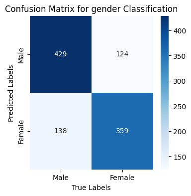
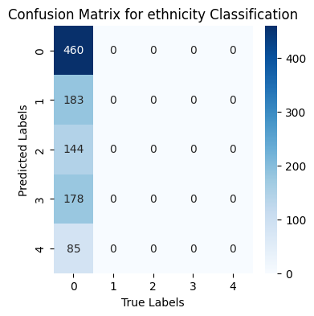

# Multi-Purpose MLP for Joint Age, Gender and Ethnicity Prediction

A single PyTorch multilayer perceptron that predicts **gender** (binary classification), **ethnicity** (5-class classification) and **age** (regression) from 48 × 48 grayscale face images at the same time. It was built as Assignment 1 of the CS 878 Deep Learning course (Fall 2023) at NUST SEECS.

## Problem and Motivation

The assignment explores **multi-task learning** with a plain feed-forward network. Instead of training three separate models, one network learns a shared image representation (the *feature extractor*), and three lightweight *output heads* use that representation for each task. The main design questions are how to structure the shared and task-specific parts, and how to combine a regression loss with two classification losses into a single training objective.

## Dataset

| Property | Value |
|---|---|
| Content | Grayscale face images (48 × 48 = 2,304 pixels), each labelled with age, gender and ethnicity |
| Size | 23,705 images in the provided CSV; a seeded random subset of **7,000** is used, as the assignment requires |
| Labels | `age`: 0–116 · `gender`: 0 = male, 1 = female · `ethnicity`: 0 = White, 1 = Black, 2 = Asian, 3 = Indian, 4 = Others |
| Split | 70 % train (4,900) / 15 % validation (1,050) / 15 % test (1,050) |
| Source | CSV provided with the course (downloaded in the notebook from a shared Google Drive link via `gdown`) |

The assignment brief doesn't name the original source. Its description, a large-scale face dataset with an age span of 0–116 years and more than 20,000 images annotated with age, gender and ethnicity, matches the UTKFace dataset. The data isn't included in this repository.

## Approach

**Pre-processing**
- The pixel strings are decoded into 2,304-dimensional vectors and scaled to [0, 1] by dividing by 255.
- Gender and ethnicity are one-hot encoded. Age is min–max scaled to [0, 1].

**Model: `MultiTaskNN`**
- **Shared feature extractor:** 5 fully connected layers with ReLU (2304 → 1024 → 1024 → 512 → 512 → 256).
- **Heads:** gender (2 units, softmax), ethnicity (5 units, softmax) and age (1 linear unit).

**Training**
- Weighted multi-task loss: `0.6 × gender cross-entropy + 0.7 × ethnicity cross-entropy + 0.3 × age MSE`.
- Adam optimiser, learning rate 1e-4, 120 epochs, full-batch (the whole training set in every step).

## Results

All numbers come from the recorded notebook outputs on the 1,050-image test set. The classification accuracies are calculated from the confusion matrices the notebook plots.

| Task | Metric | Test result |
|---|---|---|
| Gender | Accuracy | **≈ 75.0 %** (788 / 1,050) |
| Ethnicity | Accuracy | **≈ 43.8 %** (460 / 1,050): every image predicted as class 0 |
| Age | MSE (normalised age, [0, 1]) | **0.0324** |

On the training set, gender accuracy rose from 47 % to 77 % over training, ethnicity accuracy stayed at 43 %, and the normalised age MSE fell from 0.136 to 0.030.

| Gender confusion matrix | Ethnicity confusion matrix |
|---|---|
|  |  |

*In both plots the rows are the true labels and the columns are the predicted labels. The axis titles in the original figures are the wrong way round.*

### Findings
- The shared representation supports gender classification reasonably well, at about 75 % test accuracy.
- The ethnicity head collapsed to the majority class (White), so its accuracy equals that class's share of the test set.
- Age MSE is reported on min–max-normalised targets, and each split was scaled with its own range, so it isn't directly comparable to an error in years.

## Limitations and Possible Improvements

- Both classification heads apply softmax before `nn.CrossEntropyLoss`, which applies log-softmax again. This flattens the gradients. Returning raw logits is the standard fix.
- The validation split is created but not used, so the notebook has no per-epoch validation and no training or validation curves.
- The train/validation/test shuffle isn't seeded, so exact results vary between runs.
- Other untested ideas: mini-batch training, class weighting for the imbalanced ethnicity labels, and scaling age with the training-set range for every split.

## Tech Stack

- **Language:** Python
- **Deep learning:** PyTorch (`nn.Linear`, Adam, `CrossEntropyLoss`, `MSELoss`)
- **Data and evaluation:** pandas, NumPy, scikit-learn (`confusion_matrix`)
- **Visualisation:** Matplotlib, seaborn
- **Environment:** Google Colab

## Setup and Usage

```bash
git clone https://github.com/BasharatWali/Multi-Purpose-MLP-Classification-Regression.git
cd Multi-Purpose-MLP-Classification-Regression
pip install -r requirements.txt
jupyter notebook notebooks/multi_purpose_mlp_classification_regression.ipynb
```

Before running:
- The first code cell downloads the dataset CSV with `gdown`. The loading cell reads it from a Google Drive path (`/content/drive/MyDrive/Dl_Assignment/DL_assignment1_dataset.csv`), so change that path to where the CSV actually is.
- Run the PyTorch import cell, under "Convert training data to tensors", before the cell that defines `MultiTaskNN`. The original run executed them in that order even though they appear the other way round in the notebook.
- Training is full-batch on about 4,900 images and runs on a CPU, though a GPU is faster.

## Project Structure

```
Multi-Purpose-MLP-Classification-Regression/
├── notebooks/
│   └── multi_purpose_mlp_classification_regression.ipynb   # Data prep, model, training, evaluation
├── assets/                                                 # Figures exported from the notebook outputs
│   ├── confusion_matrix_gender.png
│   └── confusion_matrix_ethnicity.png
├── requirements.txt
├── .gitignore
└── README.md
```

## Author

**Basharat Ali**, National University of Sciences and Technology (NUST), Islamabad, Pakistan.

Course: CS 878 Deep Learning, Fall 2023 (instructor: Dr. Muhammad Moazam Fraz).
